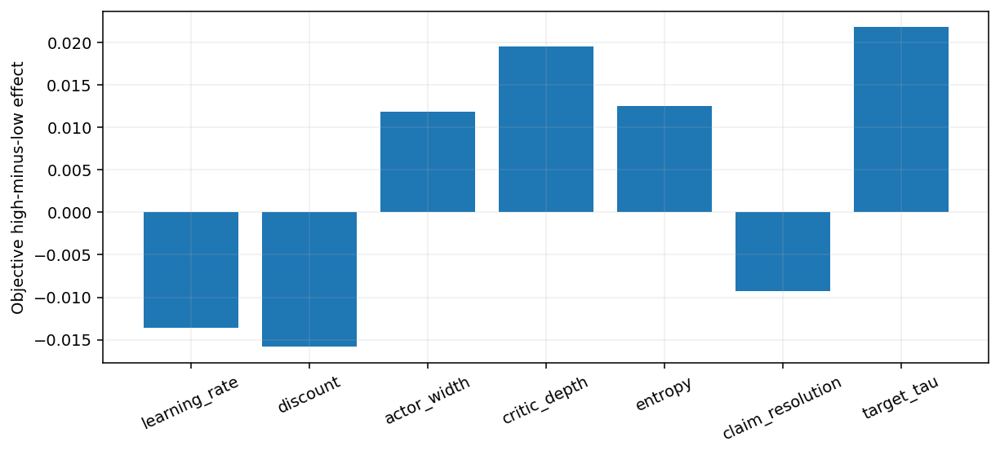
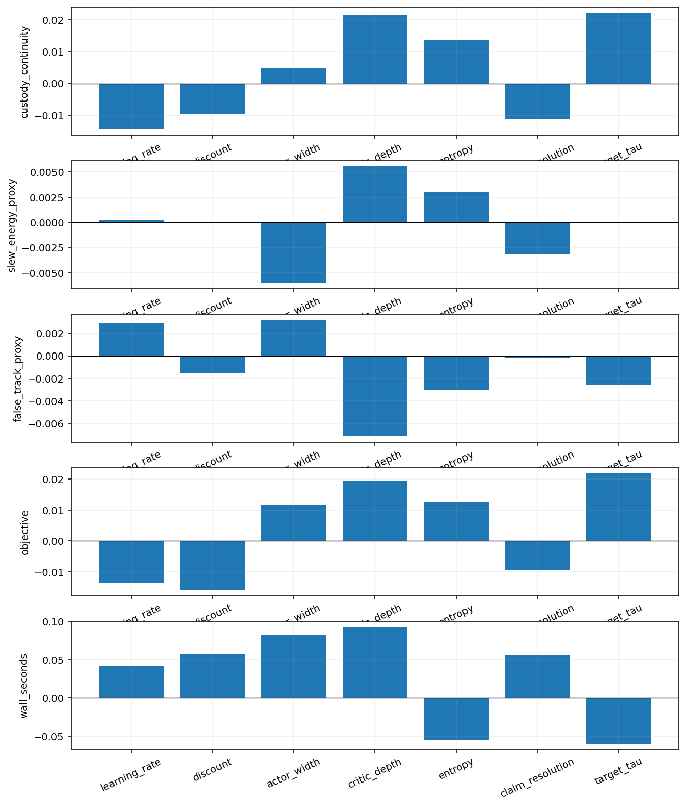
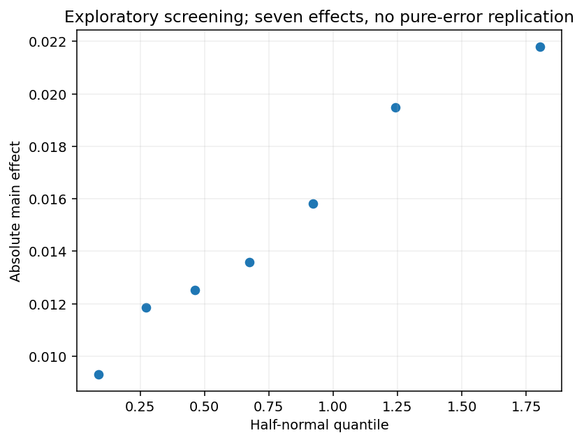
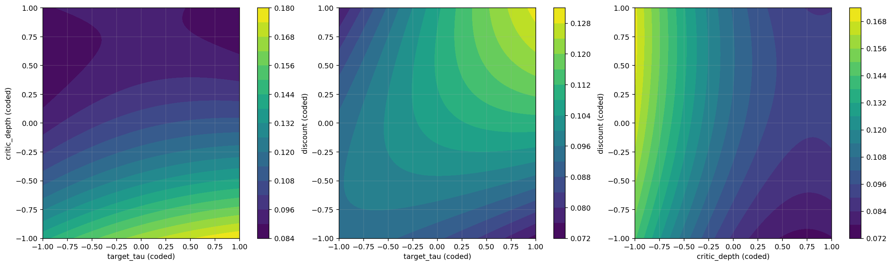
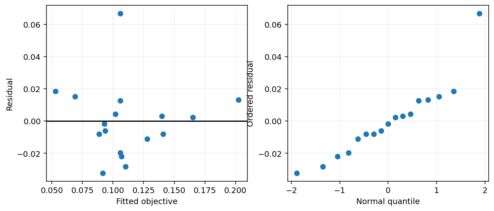
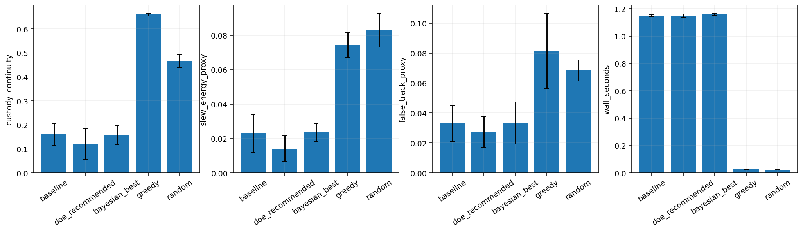

# GoDSAT historical-orbit research run

Study: **research training run**. All reported values were measured in this implementation.

This is a new shared-policy multi-agent actor-critic implementation. The original GoDSAT code, published baseline configuration, and calibrated sensor model were not supplied. The manuscript contains placeholder results; its 11–14% custody and 9% energy claims are not reproduced or assumed here.

**Ground-sensor data:** the workspace includes 247,322 ILRS LAGEOS-1 laser-ranging normal points from 39 stations. These observations were not used to fit the tasking policy or dropout model. The tasking study still assumes hypothetical satellite-hosted optical/radar sensors; no catalog-wide calibration or failed-acquisition telemetry is available.

Executed 16 screening treatments, 17 response-surface treatments, 33 Bayesian treatments, and 15 independent retrains. Training wall time: 93.4 seconds on CPU; GPU-hours = 0. No machine energy estimate is available.

## Data and scenario

Historical source spans October 2022–October 2026. Training windows are separated by date from the 2025 selection window and 2026 held-out test window. Scenario orbit regimes: {"training": ["leo"], "validation": ["leo"], "test": ["leo"]}. Sensor-host candidates come from the `current_payload` cohort; targets come from the `current_payload` cohort, which includes debris and rocket bodies when set to `all`. Each episode selects a dense observable cluster with hypothetical sensor hardware. These are short sampled windows, not four years of continuous training. All inference uses element epochs at or before the sampled time.
A separate AWP two-body plus J2 propagation check covered NORAD 63166 on 2026-10-01T00:00:00Z; maximum separation after transforming SGP4 TEME states to GCRS with Astropy was 1.866 km. This is model sensitivity, not error against measured truth.

## Screening

Correct defining relation from E=ABC, F=ABD, G=ACD: I = ABCE = ABDF = ACDG = AEFG = BCFG = BDEG = CDEF.
The manuscript’s printed relation differs from its generators. Main effects are clear of two-factor interactions, but two-factor aliases cannot be individually identified.

| Factor | Objective effect | Custody effect | Slew-proxy effect | False-track effect | Runtime effect |
|---|---:|---:|---:|---:|---:|
| learning_rate | -0.014352 | 0.000253 | 0.002867 | -0.013596 | 0.041222 |
| discount | -0.009722 | -0.000083 | -0.001497 | -0.015831 | 0.057171 |
| actor_width | 0.004861 | -0.005974 | 0.003174 | 0.011846 | 0.081873 |
| critic_depth | 0.021528 | 0.005572 | -0.007114 | 0.019486 | 0.092573 |
| entropy | 0.013657 | 0.002979 | -0.002992 | 0.012526 | -0.055022 |
| claim_resolution | -0.011343 | -0.003141 | -0.000208 | -0.009304 | 0.056260 |
| target_tau | 0.022222 | -0.000002 | -0.002538 | 0.021806 | -0.059624 |

Factors selected by measured absolute objective effect: target_tau, critic_depth, discount.
Their identities are selected from these observations; the manuscript’s learning-rate/discount/width ranking is not imposed.





## Response surface

The response-surface design has eight factorial and six axial points, plus 3 independently trained center-point observations (17 treatments total). The two added center runs estimate pure training error, enabling a formal lack-of-fit test with only two pure-error degrees of freedom. Bayesian optimization receives the matched 33-treatment budget.

| Response | Canonical classification | Residual RMSE | Lack-of-fit result |
|---|---|---:|---|
| custody_continuity | saddle_or_flat | 0.024310 | F=0.542, p=0.749, pure-error df=2 |
| slew_energy_proxy | saddle_or_flat | 0.003902 | F=0.807, p=0.635, pure-error df=2 |
| false_track_proxy | saddle_or_flat | 0.008549 | F=1.561, p=0.435, pure-error df=2 |
| objective | saddle_or_flat | 0.034660 | F=0.480, p=0.780, pure-error df=2 |
| wall_seconds | saddle_or_flat | 0.007828 | F=3.321, p=0.247, pure-error df=2 |
Bounded local recommendation (integer factors rounded before retraining):

```json
{
  "learning_rate": 0.000505,
  "discount": 0.99,
  "actor_width": 160,
  "critic_depth": 2,
  "entropy": 0.055,
  "claim_resolution": 80,
  "target_tau": 0.05
}
```

The constrained numerical optimum is exploratory. Review residuals and holdout performance before accepting it; an optimizer returning a point is not evidence of model adequacy.




## Held-out comparison

Means with 95% Student-t interval half-widths over five independent training/evaluation seeds. Slew energy is a normalized squared-angle proxy; false-track rate is the failed-observation proxy, not measured false positives. Wall time is end-to-end per seed: training, validation, and held-out evaluation for learned policies; held-out evaluation for non-learning baselines. “not recorded” marks legacy results whose non-learning baseline runtimes were not measured.

| Configuration | Custody | Slew proxy | False-track proxy | Mean end-to-end wall seconds per seed |
|---|---:|---:|---:|---:|
| baseline | 0.1606 ± 0.0454 | 0.0231 ± 0.0109 | 0.0330 ± 0.0121 | 1.149 ± 0.007 |
| doe_recommended | 0.1209 ± 0.0640 | 0.0142 ± 0.0074 | 0.0276 ± 0.0102 | 1.147 ± 0.013 |
| bayesian_best | 0.1574 ± 0.0391 | 0.0235 ± 0.0054 | 0.0334 ± 0.0141 | 1.161 ± 0.007 |
| greedy | 0.6604 ± 0.0056 | 0.0744 ± 0.0071 | 0.0814 ± 0.0253 | 0.026 ± 0.000 |
| random | 0.4663 ± 0.0277 | 0.0830 ± 0.0099 | 0.0685 ± 0.0070 | 0.023 ± 0.000 |



Descriptive cost-performance ratios use held-out custody or normalized slew proxy divided by measured end-to-end wall seconds for the same seed. They are not electrical energy efficiency. Learned-policy time includes training and test evaluation; greedy/random time covers evaluation only, so these accounting scopes differ. No calibrated energy measurement or GPU-hours are available for this CPU campaign.

| Configuration | Custody per wall second | Slew proxy per wall second |
|---|---:|---:|
| baseline | 0.139820 ± 0.039896 | 0.020075 ± 0.009503 |
| bayesian_best | 0.135545 ± 0.033103 | 0.020245 ± 0.004570 |
| doe_recommended | 0.105563 ± 0.056440 | 0.012390 ± 0.006477 |
| greedy | 25.162890 ± 0.340028 | 2.835202 ± 0.263555 |
| random | 20.696013 ± 1.333928 | 3.682187 ± 0.450097 |

Paired DOE-minus-baseline changes:

```json
{
  "custody_continuity": {
    "paired_mean_change": -0.03962962962962961,
    "paired_ci95_half_width": 0.07078947335748367,
    "relative_change_percent": -24.68281430219146
  },
  "slew_energy_proxy": {
    "paired_mean_change": -0.008840453729750527,
    "paired_ci95_half_width": 0.01348819061239662,
    "relative_change_percent": -38.346774013645046
  },
  "false_track_proxy": {
    "paired_mean_change": -0.005485407210165026,
    "paired_ci95_half_width": 0.017393247490982006,
    "relative_change_percent": -16.601429762874798
  },
  "objective": {
    "paired_mean_change": -0.036308860462181555,
    "paired_ci95_half_width": 0.06401127668887023,
    "relative_change_percent": -38.27467193265326
  }
}
```

Bayesian optimization uses a fixed-prior Matérn-3/2 Gaussian process with expected improvement over a 2,048-point candidate pool and the same number of training treatments. The kernel uses a unit length scale and 0.1 observation noise with Cholesky stabilization. It is budget-matched by run count and episode count, not equal wall time. Hyperparameter widths/depths change compute cost.

A 128-run two-level full factorial versus 33 DOE runs is about a 3.9× reduction, not an order of magnitude. No random-search campaign was run.

## Reproducibility

See design CSVs, per-run JSON metadata, model checkpoints, validation seeds, raw responses, coefficients/covariance, ANOVA, and cached scenario source epochs. The baseline is an explicitly chosen reference configuration, not the unpublished original baseline.

The full campaign completed as configured, but the results remain exploratory. Short episode windows, one date in each validation/test split, unavailable published baseline implementation/configuration, missing catalog-wide sensor calibration, and reduced-precision orbital elements limit scientific conclusions. The ILRS observations are not used as sensor-model calibration or dropout labels. Original raw TLE/OMM and representative calibrated sensor data are needed for operational claims.
