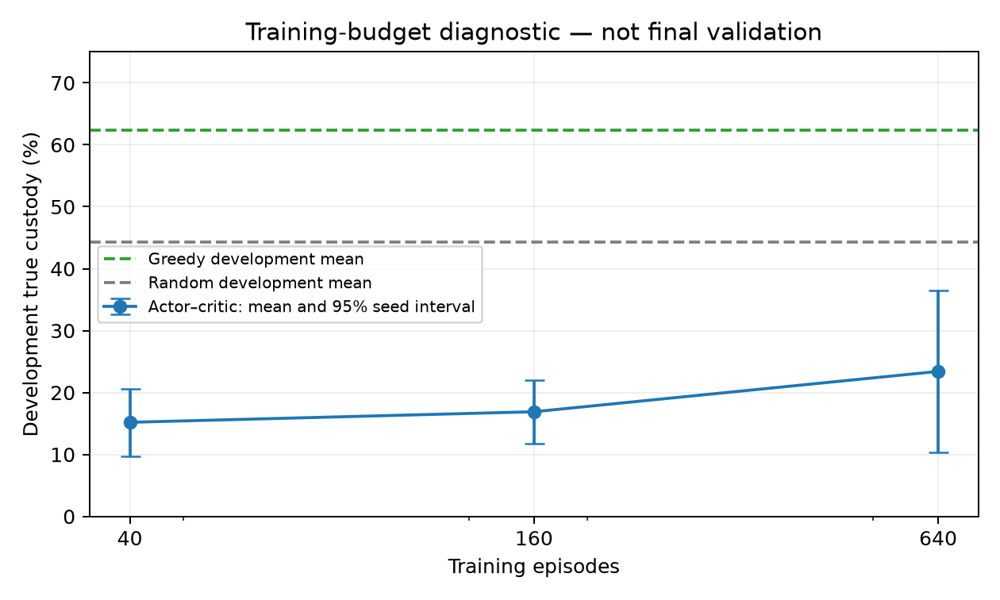

# Results and current status

## Current study scope

The requested participating systems are **Iridium NEXT and ground systems**, with an optional MEO extension. MEO is disabled. NEXT membership and historical orbital inputs are prepared, but ground-system roles remain unresolved. There is no completed tracking-performance experiment for this combined scope.

The earlier learning and dropout experiments below used other satellite selections. Their numerical results must not be presented as Iridium NEXT plus ground performance.

## Findings available now

| Work | Finding | Evidence |
| --- | --- | --- |
| NEXT membership | 80 listed spacecraft, including spares; 290,075 extracted historical element records. Membership does not prove historical operational status. | [Scope audit](evidence/iridium-next-scope/audit.json) |
| Training-budget diagnostic | Development custody means: 15.2% at 40 episodes, 16.9% at 160, 23.4% at 640. Three training seeds; stability and convergence were not established. | [Summary](evidence/training-budget/summary.json), [raw responses](evidence/training-budget/development-responses.csv), [replay audit](evidence/training-budget/audit.json) |
| Earlier physical-response adaptation | DOE recommendation changed held-out custody by −0.35 percentage points; the paired interval spans deterioration and improvement. No custody gain or energy reduction established. | [Summary](evidence/physical-adaptation/summary.json), [validation rows](evidence/physical-adaptation/validation.csv) |
| Response-surface checks | Custody and energy quadratic fits failed the reported lack-of-fit checks. An accepted optimum is not established. | [Augmented fits](evidence/physical-center-check/response_surfaces_augmented.json) |
| Lean mathematics | 62 theorems checked; design corrections and conditional model results. This does not prove empirical gains, calibration, or whole-controller equivalence. | [Verification receipt](evidence/lean/lean-verification.json), [proof project](../formal/README.md) |
| Original-controller audit | Original source uses Q-table/gradient tasking. A concrete headless source/port difference remains; the published actor–critic baseline was not identified. | [Source audit](evidence/source-audit/upstream-source-audit.json), [controller probe](evidence/controller-probes/original-controller-probe.json) |

The draft's claimed **11–14% custody improvement, 9% energy reduction, and tenfold training-run reduction are not established results**. Its 128-versus-31 run count is a 4.13 ratio, not a measurement of compute savings.

## Detailed dated reports

- [Training-budget diagnostic — 2026-11-01](baseline-training-budget-20261101.md)
- [Source fidelity and formal verification — 2026-10-27](faithful-reproduction-20261027.md)
- [Physical-response adaptation — 2026-10-25](governing-design-study-20261025.md)
- [Broader historical synthesis — 2026-10-24](current-study-20261024.md)
- [Older report snapshots](archive/README.md)

Dated reports preserve their original text and provenance; some links refer to local `outputs/` or pre-reorganization paths. Use [the migration map](../docs/repository-layout.json) for moved source files. Older completion wording does not establish the new study's completion.

## Shared evidence versus local artifacts

`evidence/manifest.json` records byte hashes for the compact shared snapshots. Full raw inputs, trained models, source snapshots, and most generated outputs remain local under `data/` and `outputs/`. These files are excluded from Git to keep the repository small. A compact receipt is evidence of its stated checks, not a substitute for missing experimental inputs or a broader claim of validation.

The default portable suite uses synthetic fixtures. Supplementary research tests additionally require local artifacts; three checks currently lack the catalogue-refresh, MOST, and Sentinel inventory files. They are outside the default CI suite and are not reported as passed.
