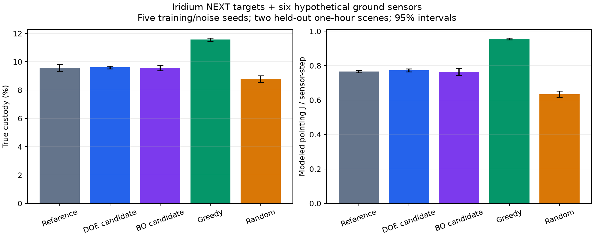
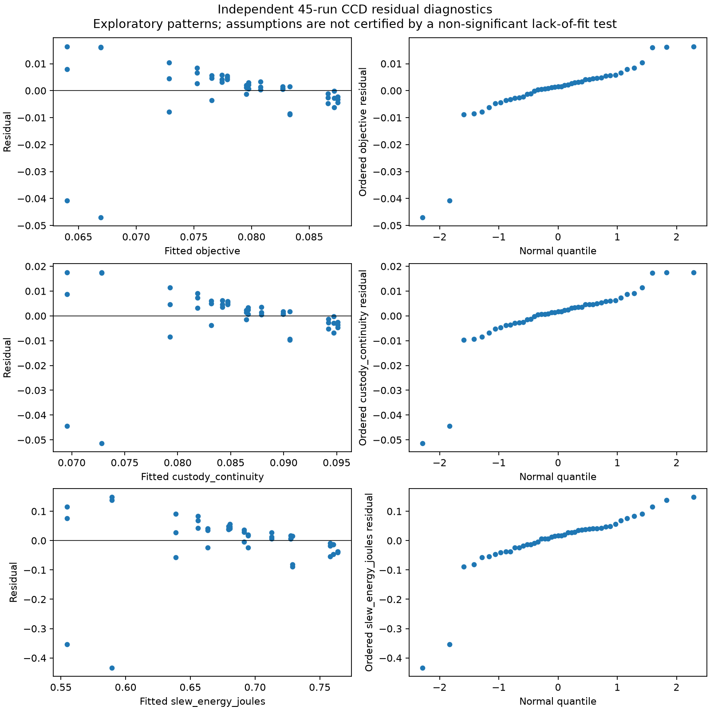
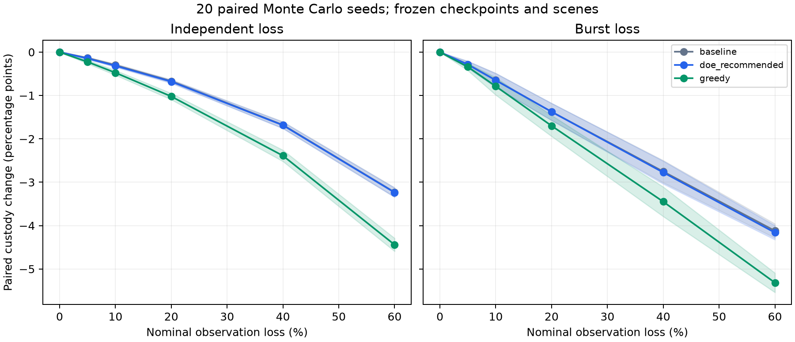

# Iridium NEXT and ground tracking — rerun results, 2026-11-04

**Completed:** 122 trained models, 25 held-out policy/seed rows, and 5,280 dropout episodes. The two claimed primary gains were not established.

[Registered protocol](evidence/iridium-next-ground-20261104/registered-plan.json) · [Independent statistics audit](evidence/iridium-next-ground-20261104/independent-statistics-audit.json) · [Exact executed source](evidence/iridium-next-ground-20261104/executed-source.tar.gz)

## Systems and assumptions

All 80 pinned NEXT spacecraft, including listed spares, are tracking targets. Six hypothetical ground sensors are co-located at published SLRF2020 monument positions: Yarragadee, Greenbelt, Haleakala, Changchun, Hartebeesthoek and Wettzell. No MEO or other orbital constellation is included. Ground tracking is an explicit execution assumption, not an author-supplied architecture or measured station capability.

Training uses three dated hours in 2022–2024, development selection one hour in 2025, and final evaluation two hours on 2026-08-15 and 2026-09-15. Missing element histories stay unavailable. The earliest training scene has 75 valid target histories; all 80 target slots remain in every scene. These are sampled hours, not continuous four-year operations.

Each run has 40 training episodes. Convergence is not established. Published station coordinates are used with assumed detection/clutter and pointing mechanics, a 10-degree elevation mask and 60-second steps. There is no measured NEXT sensor calibration, weather or exposure model. Pointing energy excludes total station power. Historical ephemeris geometry remains available to the policy; dropout suppresses sensor returns, not position truth.

## Held-out comparison

Mean ± 95% Student-t half-width over five seeds, each averaged over the same two held-out scenes. Custody includes every target with a valid state, including targets below the ground network’s horizon; it is not coverage restricted to visible targets.

| Policy | True custody | Modeled pointing J / sensor per 60-second step |
| --- | ---: | ---: |
| Reference | 9.575% ± 0.233 pp | 0.766159 ± 0.006702 |
| DOE candidate | 9.600% ± 0.093 pp | 0.772400 ± 0.008880 |
| BO candidate | 9.567% ± 0.183 pp | 0.764382 ± 0.020322 |
| Greedy | 11.567% ± 0.110 pp | 0.955319 ± 0.005237 |
| Random | 8.792% ± 0.231 pp | 0.634318 ± 0.018086 |

DOE minus reference custody is **+0.025 percentage points**, with family-adjusted interval [-0.222, +0.272]. The point relative change is +0.261%.

Modeled pointing energy changes by **+0.006242 J / sensor-step**, interval [-0.007582, +0.020065], a point relative change of +0.815%. Positive values are increases. Both intervals include zero. The two 97.5% intervals implement the registered Bonferroni family rule; neither the custody-gain nor energy-reduction claim is established.

Greedy achieves higher custody while using more modeled pointing energy. This is a trade-off in these scenes, not evidence of a learned-policy advantage or an operational energy budget.

## Response-surface diagnostics

The screen and unique-point CCD contain 16 and 15 treatments; BO has 31 trials. Factors selected by the measured screen were entropy, claim_resolution, actor_width. Actor width is isolated from a fixed critic width of 128.

An additional 45 development-only runs give three distinct training seeds at every CCD point, with 30 pure-error and five lack-of-fit degrees of freedom. They are outside the original optimization budget. Lack of fit was not detected for objective, custody or energy under the classical test assumptions:

| Response | Lack-of-fit p-value |
| --- | ---: |
| objective | 0.5909 |
| custody_continuity | 0.5795 |
| slew_energy_joules | 0.4526 |

Nonrejection does not prove adequacy or an optimum. The false-track diagnostic had no positive pure-error variance, so its test was unavailable; zero observed events do not establish zero risk. No further tuning used final-test outcomes.

## Paired observation losses

At nominal 20% loss, changes below compare each policy to its own paired no-loss Monte Carlo reference, not to a different primary-evaluation noise sample. Intervals cover 20 noise replicates conditional on the frozen checkpoints and scenes; they do not include training- or scenario-population uncertainty.

| Policy | Independent loss, custody change (pp) | Burst loss, custody change (pp) |
| --- | ---: | ---: |
| baseline | -0.669 [-0.704, -0.634] | -1.376 [-1.573, -1.180] |
| doe_recommended | -0.680 [-0.718, -0.642] | -1.376 [-1.574, -1.179] |
| greedy | -1.022 [-1.095, -0.949] | -1.700 [-1.942, -1.458] |

Burst outages caused larger reductions here at equal nominal probability. Realized missed-look counts and adaptive actions differ; this does not isolate timing alone or establish fleet failure rates.

## Validation and compute

All 122 saved development model responses and 25 held-out rows replayed. Independent action reconstruction checked 50 held-out traces and 88 dropout traces. All 122 treatment signatures and 4,880 finite training losses checked; three entire training trajectories and weight sets repeated exactly. The separate statistic audit reconciles primary intervals, all dropout effects and replicated fits, including 440 exact zero-loss control pairs.

The registered end-to-end runner took 420.0 seconds on this machine, including diagnostics/dropout/replays but excluding later reporting and extra training-repeat checks. Primary aggregate treatment/evaluation wall duration was 359.2 seconds. Parallel DOE and sequential BO do not support an elapsed-time efficiency ranking. GPU use was zero; no calibrated machine energy or tenfold compute saving is claimed.

The exact scientific source snapshot is retained because report wording and CLI/data-readiness safeguards were subsequently improved. Numerical outputs are preserved, with file hashes below. Reproduction with changed source requires a new output folder. The original published neural baseline and calibrated hardware improvements remain unverified.

[Raw held-out rows](evidence/iridium-next-ground-20261104/validation.csv) · [Raw dropout responses](evidence/iridium-next-ground-20261104/dropout-responses.csv) · [Model/seed/hash index](evidence/iridium-next-ground-20261104/treatment-index.json)
